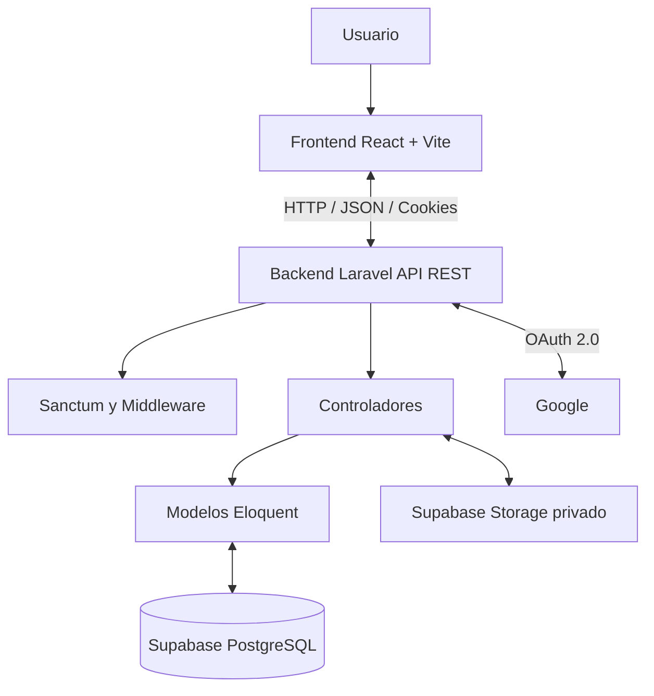
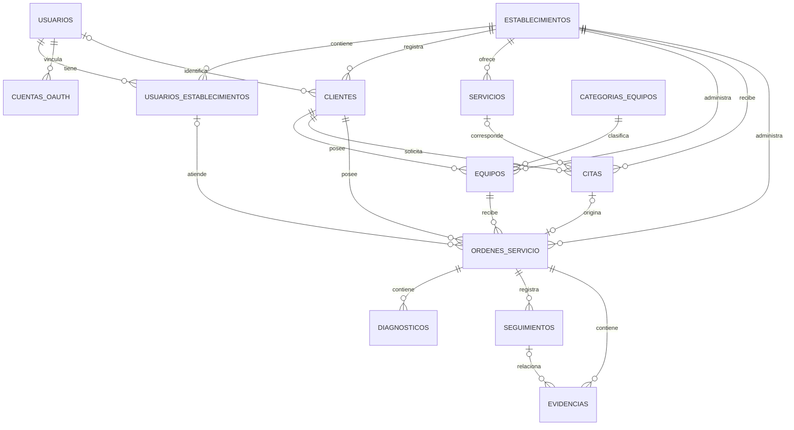
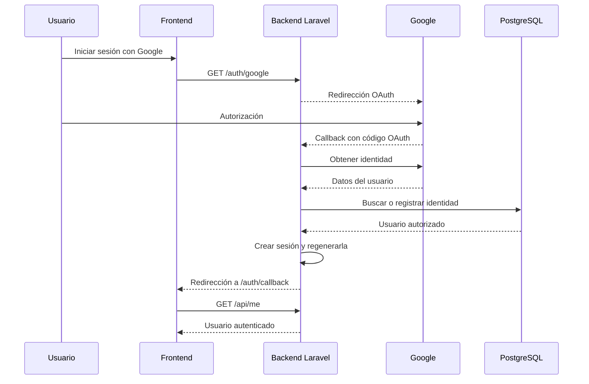
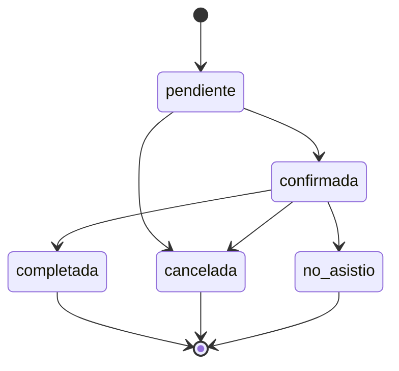
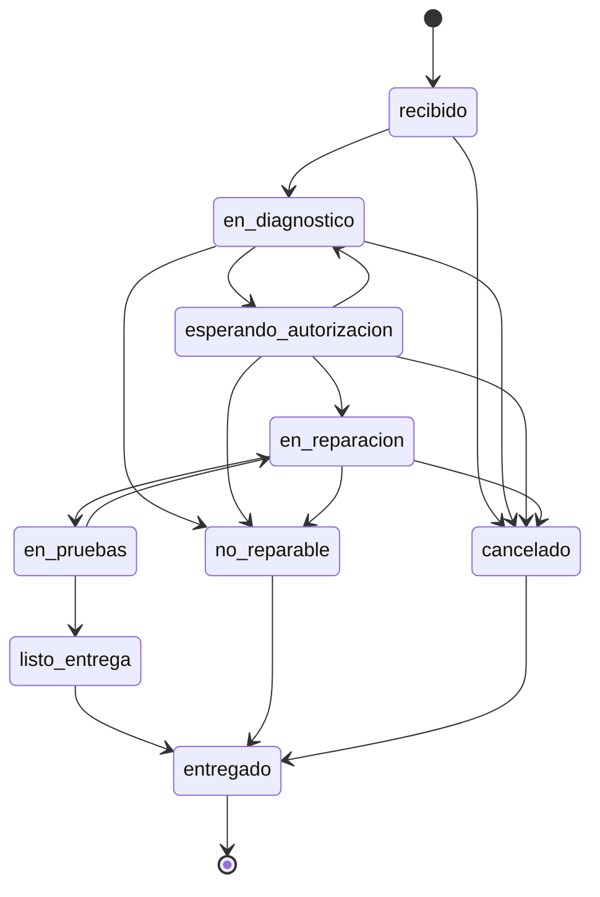
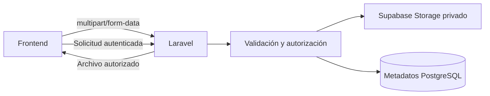
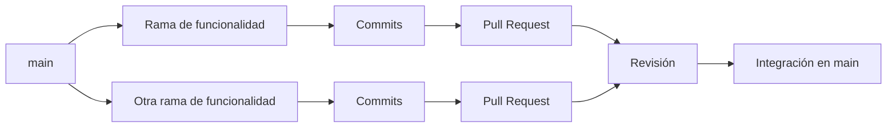

# RepairHub — Backend API REST

**Sistema integral para la gestión de establecimientos de reparación y seguimiento de órdenes de servicio.**

## Backend realizado por:
- Hugo Baruch Rivera Morales
- Abraham Silva Mendez
---

## 1. Descripción del proyecto

RepairHub es una plataforma web diseñada para facilitar la administración de establecimientos dedicados a la reparación y mantenimiento de equipos, dispositivos electrónicos, electrodomésticos, vehículos y otros bienes que requieren servicios técnicos.

El sistema centraliza la información de los establecimientos, usuarios, técnicos, clientes, equipos, servicios, citas y órdenes de reparación, permitiendo llevar un control organizado de cada etapa del proceso.

Además, proporciona un portal para que los clientes puedan consultar el estado de sus reparaciones, revisar el historial de avances y visualizar las evidencias fotográficas autorizadas por el establecimiento.

El proyecto utiliza una arquitectura desacoplada, en la cual el frontend y el backend se desarrollan de manera independiente y se comunican mediante una API REST.

Este repositorio contiene el backend de RepairHub, desarrollado con Laravel, encargado de administrar la lógica de negocio, autenticación, autorización, validación de información, persistencia de datos y almacenamiento seguro de archivos.

## 2. Objetivos

### 2.1. Objetivo general

Desarrollar una plataforma web que permita administrar de manera centralizada, segura y eficiente los procesos de reparación de diferentes establecimientos, facilitando la comunicación entre administradores, técnicos y clientes.

### 2.2. Objetivos específicos

- Implementar una API REST para la comunicación entre el frontend y el backend.
- Proporcionar mecanismos de autenticación mediante credenciales y Google OAuth 2.0.
- Implementar sesiones seguras mediante cookies HttpOnly y Laravel Sanctum.
- Permitir la administración de múltiples establecimientos dentro de una misma plataforma.
- Gestionar los permisos de los usuarios mediante roles y membresías.
- Administrar clientes, equipos, servicios y citas.
- Registrar órdenes de reparación mediante folios únicos.
- Controlar las transiciones entre los diferentes estados de una reparación.
- Registrar diagnósticos, notas internas y seguimientos.
- Almacenar evidencias fotográficas mediante Supabase Storage.
- Proporcionar un portal de seguimiento seguro para los clientes.
- Proteger los recursos contra accesos no autorizados.
- Facilitar la integración con aplicaciones frontend independientes.

## 3. Funcionalidades principales

| Módulo | Descripción |
|---|---|
| Autenticación | Registro, inicio de sesión, cierre de sesión y consulta del usuario autenticado. |
| Google OAuth | Autenticación mediante una cuenta de Google. |
| Establecimientos | Creación y administración de negocios independientes. |
| Membresías | Asociación de usuarios con establecimientos y roles. |
| Técnicos | Incorporación, consulta y desactivación de técnicos. |
| Clientes | Registro, búsqueda, modificación y eliminación lógica de clientes. |
| Equipos | Administración de los equipos asociados a cada cliente. |
| Categorías | Clasificación de equipos y características dinámicas. |
| Servicios | Administración del catálogo de servicios del establecimiento. |
| Página pública | Consulta de información y servicios de un establecimiento mediante su slug. |
| Citas | Solicitud, programación, confirmación y administración de citas. |
| Órdenes | Registro y administración de reparaciones mediante folios únicos. |
| Diagnósticos | Registro de problemas identificados y reparaciones sugeridas. |
| Seguimientos | Historial de estados y notas de avance. |
| Evidencias | Carga, consulta, modificación y eliminación de fotografías. |
| Portal del cliente | Consulta autenticada de reparaciones propias. |
| Seguridad | Validación de permisos, propiedad de recursos y aislamiento entre establecimientos. |

## 4. Arquitectura del sistema

RepairHub utiliza una arquitectura cliente-servidor con separación de responsabilidades entre la interfaz de usuario, la lógica de negocio y los servicios de persistencia.



### 4.1. Frontend

Responsable de:

- Presentar las interfaces de usuario.
- Gestionar formularios y navegación.
- Consumir los endpoints de la API.
- Mostrar información según los permisos del usuario.
- Administrar el estado de autenticación.
- Mostrar órdenes, diagnósticos, seguimientos y evidencias.
- Interpretar las respuestas y errores del backend.

### 4.2. Backend

Responsable de:

- Procesar las peticiones HTTP.
- Validar los datos recibidos.
- Autenticar usuarios.
- Verificar roles y permisos.
- Ejecutar las reglas de negocio.
- Consultar y modificar la base de datos.
- Administrar archivos privados.
- Generar respuestas JSON.

### 4.3. Base de datos

Se utiliza PostgreSQL mediante Supabase como servicio de base de datos relacional.

Laravel establece la conexión mediante el controlador `pgsql` y utiliza Eloquent ORM y Query Builder para interactuar con los registros.

### 4.4. Almacenamiento de archivos

Las evidencias fotográficas se almacenan en un bucket privado de Supabase Storage mediante su interfaz compatible con S3.

El frontend no accede directamente al bucket. Todas las solicitudes de archivos pasan por el backend, donde se verifica la autorización correspondiente.

## 5. Tecnologías utilizadas

| Tecnología | Aplicación |
|---|---|
| PHP 8.3 o compatible superior | Lenguaje de programación del backend. |
| Laravel 13 | Framework principal de desarrollo. |
| Laravel Sanctum 4 | Autenticación mediante sesiones y tokens. |
| Laravel Socialite 5 | Integración con Google OAuth. |
| PostgreSQL | Sistema gestor de base de datos. |
| Supabase | Servicio de base de datos y almacenamiento. |
| Flysystem AWS S3 v3 | Comunicación con Supabase Storage. |
| Composer | Administración de dependencias PHP. |
| Eloquent ORM | Administración de modelos y relaciones. |
| PHPUnit | Pruebas automatizadas. |
| Postman | Pruebas funcionales de la API. |
| Git | Control de versiones. |
| GitHub | Repositorio y colaboración. |
| React | Tecnología del frontend independiente. |
| Vite | Entorno de desarrollo del frontend. |
| Axios | Cliente HTTP recomendado para la integración. |

Las versiones exactas de las dependencias del backend se encuentran registradas en `composer.json` y `composer.lock`.

## 6. Estructura del repositorio

```text
Repairhub/
├── app/
│   ├── Http/
│   │   ├── Controllers/
│   │   │   ├── AuthController.php
│   │   │   ├── OAuthController.php
│   │   │   ├── EstablecimientoController.php
│   │   │   ├── TecnicoController.php
│   │   │   ├── ClienteController.php
│   │   │   ├── EquipoController.php
│   │   │   ├── ServicioController.php
│   │   │   ├── CitaController.php
│   │   │   ├── PublicoController.php
│   │   │   ├── OrdenController.php
│   │   │   ├── EvidenciaController.php
│   │   │   └── PortalClienteController.php
│   │   └── Middleware/
│   │       └── VerificarMembresia.php
│   ├── Models/
│   │   ├── Usuario.php
│   │   ├── UsuarioEstablecimiento.php
│   │   ├── Establecimiento.php
│   │   ├── Cliente.php
│   │   ├── Equipo.php
│   │   ├── Servicio.php
│   │   ├── Cita.php
│   │   ├── Orden.php
│   │   ├── Diagnostico.php
│   │   ├── Seguimiento.php
│   │   ├── Evidencia.php
│   │   ├── CuentaOAuth.php
│   │   └── CodigoOAuth.php
│   └── Services/
│       ├── GoogleOAuthService.php
│       └── CodigoOAuthService.php
├── bootstrap/
│   └── app.php
├── config/
│   ├── app.php
│   ├── auth.php
│   ├── database.php
│   ├── equipos.php
│   ├── filesystems.php
│   ├── sanctum.php
│   ├── services.php
│   └── session.php
├── database/
│   ├── migrations/
│   ├── factories/
│   ├── seeders/
│   └── sql/
│       ├── 002_crear_cuentas_oauth.sql
│       └── 003_crear_codigos_oauth.sql
├── routes/
│   ├── api.php
│   ├── negocio.php
│   ├── portal.php
│   ├── web.php
│   └── console.php
├── tests/
│   ├── Feature/
│   │   └── PortalClienteTest.php
│   └── Unit/
├── public/
├── storage/
├── .env.example
├── composer.json
├── composer.lock
├── artisan
└── README.md
```

### 6.1. Controladores

Los controladores reciben las peticiones del frontend, validan los parámetros, ejecutan las reglas de negocio y generan las respuestas HTTP.

### 6.2. Modelos

Los modelos representan las entidades de la base de datos y permiten definir relaciones, atributos, conversiones de tipos y operaciones de persistencia.

### 6.3. Servicios

Los servicios encapsulan procesos especializados, como la autenticación mediante Google y el intercambio de códigos OAuth.

### 6.4. Middleware

El middleware `VerificarMembresia` comprueba que el usuario autenticado tenga una membresía activa dentro del establecimiento solicitado y que su rol permita realizar la operación.

### 6.5. Rutas

| Archivo | Responsabilidad |
|---|---|
| `routes/api.php` | Autenticación, establecimientos, categorías y endpoints públicos. |
| `routes/negocio.php` | Operaciones administrativas y técnicas de cada establecimiento. |
| `routes/portal.php` | Endpoints exclusivos del portal del cliente. |
| `routes/web.php` | Redirecciones y callback de Google OAuth. |
| `bootstrap/app.php` | Configuración de rutas, middleware y respuestas de excepciones. |

## 7. Diseño de la base de datos

La base de datos utiliza un modelo relacional que permite administrar múltiples establecimientos sin mezclar la información de sus operaciones.

### 7.1. Entidades principales

| Tabla | Descripción |
|---|---|
| `usuarios` | Cuentas de acceso al sistema. |
| `cuentas_oauth` | Identidades asociadas a proveedores OAuth. |
| `codigos_oauth` | Códigos temporales utilizados por el mecanismo de intercambio OAuth. |
| `personal_access_tokens` | Tokens de acceso administrados por Sanctum. |
| `establecimientos` | Información de los negocios. |
| `usuarios_establecimientos` | Membresías y roles de los usuarios. |
| `clientes` | Clientes registrados por cada establecimiento. |
| `categorias_equipos` | Clasificación de los equipos. |
| `equipos` | Equipos asociados a los clientes. |
| `servicios` | Catálogo de servicios de reparación. |
| `citas` | Solicitudes y programación de servicios. |
| `ordenes_servicio` | Órdenes de reparación. |
| `diagnosticos` | Diagnósticos asociados a las órdenes. |
| `cotizaciones` | Cotizaciones consultadas por las reglas de autorización de reparación. |
| `seguimientos` | Historial de estados y notas de avance. |
| `evidencias` | Metadatos de las fotografías almacenadas. |

### 7.2. Relaciones principales



### 7.3. Diferencia entre usuario y cliente

Una cuenta de usuario representa una identidad que puede autenticarse en el sistema.

Un cliente representa una persona registrada dentro de un establecimiento.

Ambos registros pueden vincularse mediante:

```text
clientes.usuario_id → usuarios.id
```

Esta relación permite identificar las órdenes que pertenecen al usuario autenticado cuando ingresa al portal del cliente.

Un usuario puede estar asociado con registros de cliente de diferentes establecimientos.

### 7.4. Eliminación lógica

Determinadas entidades utilizan `SoftDeletes`, lo que permite conservar los registros históricos sin eliminarlos físicamente de la base de datos.

Se utiliza el campo `eliminado_en` para identificar los registros eliminados lógicamente.

Los técnicos y servicios pueden desactivarse mediante el atributo `activo`, conservando sus referencias históricas.

## 8. Instalación y configuración local

### 8.1. Requisitos

- Git.
- PHP 8.3 o una versión superior compatible con las dependencias.
- Composer.
- Extensión PHP `pdo_pgsql`.
- Extensiones PHP requeridas por Laravel y Composer.
- Acceso a una base de datos PostgreSQL con el esquema de RepairHub.
- Credenciales de Google OAuth para utilizar la autenticación externa.
- Credenciales de Supabase Storage para utilizar evidencias.
- Node.js y npm para ejecutar el frontend independiente.

### 8.2. Clonar el repositorio

```bash
git clone https://github.com/4bram/Repairhub.git

cd Repairhub
```

### 8.3. Instalar dependencias

```bash
composer install
```

### 8.4. Crear el archivo de entorno

```bash
cp .env.example .env
```

Generar la clave de la aplicación:

```bash
php artisan key:generate
```

### 8.5. Configuración general

Editar el archivo `.env`:

```env
APP_NAME=RepairHub
APP_ENV=local
APP_DEBUG=true
APP_URL=http://localhost:8001

APP_LOCALE=es
APP_FALLBACK_LOCALE=en

FRONTEND_URL=http://localhost:5173

CACHE_STORE=file
QUEUE_CONNECTION=sync
FILESYSTEM_DISK=local
```

### 8.6. Configuración de PostgreSQL

```env
DB_CONNECTION=pgsql
DB_HOST=HOST_DE_SUPABASE
DB_PORT=PUERTO_DE_CONEXION
DB_DATABASE=postgres
DB_USERNAME=USUARIO_DE_POSTGRESQL
DB_PASSWORD=CONTRASENA_DE_POSTGRESQL
DB_SSLMODE=require
```

Los valores deben obtenerse desde la configuración de conexión del proyecto de Supabase.

Si se utiliza un pooler de conexiones, deben emplearse el host, puerto y nombre de usuario proporcionados específicamente para ese modo de conexión.

Verificar la conectividad:

```bash
php artisan tinker
```

```php
DB::select('SELECT 1 AS conexion');
```

Salir:

```php
exit
```

### 8.7. Configuración de la base de datos

El proyecto utiliza un esquema PostgreSQL administrado mediante Supabase.

El repositorio contiene scripts SQL para las tablas OAuth y una migración para los tokens personales de Sanctum.

```text
database/sql/002_crear_cuentas_oauth.sql
database/sql/003_crear_codigos_oauth.sql
database/migrations/
```

Para una instalación desde cero es necesario disponer también del esquema principal de RepairHub.

Antes de ejecutar migraciones sobre una base de datos compartida, revisar su estado:

```bash
php artisan migrate:status
```

Cuando corresponda y exista autorización para modificar la base de datos:

```bash
php artisan migrate
```

**Advertencia:** no ejecutar `migrate:fresh`, `migrate:refresh` ni `db:wipe` sobre la base de datos compartida de Supabase, debido a que podrían eliminar información existente.

### 8.8. Configuración de Sanctum y sesiones

```env
SANCTUM_STATEFUL_DOMAINS=localhost:5173

SESSION_DRIVER=cookie
SESSION_LIFETIME=480
SESSION_DOMAIN=null
SESSION_PATH=/
SESSION_SECURE_COOKIE=false
SESSION_HTTP_ONLY=true
SESSION_SAME_SITE=lax
```

Esta configuración corresponde al entorno de desarrollo local mediante HTTP.

El frontend y el backend deben utilizar nombres de host compatibles. Se recomienda utilizar `localhost` de manera consistente en las URL visibles para el navegador.

### 8.9. Configuración de Google OAuth

```env
GOOGLE_CLIENT_ID=CLIENT_ID_DE_GOOGLE
GOOGLE_CLIENT_SECRET=CLIENT_SECRET_DE_GOOGLE
GOOGLE_REDIRECT_URI=http://localhost:5173/auth/google/callback

FRONTEND_URL=http://localhost:5173
```

La URL anterior corresponde a la configuración local recomendada mediante un proxy de Vite.

En Google Cloud Console se debe crear un cliente OAuth de tipo aplicación web y registrar exactamente la URI de redirección utilizada.

Si se utiliza una conexión directa al backend, deberá configurarse la URI correspondiente al servidor Laravel y ajustar la configuración de cookies y CORS.

Las credenciales de Google deben permanecer exclusivamente en el backend.

### 8.10. Configuración de Supabase Storage

```env
SUPABASE_STORAGE_BUCKET=repairhub-evidencias
SUPABASE_S3_REGION=REGION_DEL_PROYECTO
SUPABASE_S3_ENDPOINT=ENDPOINT_S3
SUPABASE_S3_ACCESS_KEY=ACCESS_KEY
SUPABASE_S3_SECRET_KEY=SECRET_KEY
```

El bucket debe configurarse como privado.

Tipos de archivo utilizados:

- `image/jpeg`
- `image/png`
- `image/webp`

El backend establece un límite de 5 MB por evidencia.

La configuración del disco se encuentra en:

```text
config/filesystems.php
```

Laravel utiliza el disco denominado `evidencias` para almacenar y recuperar los archivos.

### 8.11. Ejecutar el servidor

```bash
php artisan optimize:clear

php artisan serve --host=127.0.0.1 --port=8001
```

URL local:

```text
http://localhost:8001
```

### 8.12. Verificar el funcionamiento

Consultar:

```http
GET /api/ping
```

Respuesta esperada:

```json
{
  "ok": true
}
```

También se encuentra disponible la ruta de salud:

```http
GET /up
```

Consultar todas las rutas registradas:

```bash
php artisan route:list
```

Consultar únicamente los endpoints de la API:

```bash
php artisan route:list --path=api
```

## 9. Autenticación y autorización

RepairHub utiliza Laravel Sanctum para proporcionar dos mecanismos de autenticación.

### 9.1. Autenticación mediante sesiones y cookies

Es el mecanismo recomendado para el frontend web.

Cuando una petición proviene de un frontend reconocido como stateful, Laravel utiliza una sesión autenticada mediante el guard `web`.

La cookie de sesión contiene el identificador o información de sesión administrada por Laravel y está protegida mediante el atributo HttpOnly.

JavaScript no necesita acceder al contenido de esta cookie.

El navegador la envía automáticamente en las solicitudes correspondientes.

### 9.2. Autenticación mediante Bearer Token

Está destinada a clientes externos, herramientas de pruebas y peticiones que no utilizan una sesión web.

Cuando el inicio de sesión se realiza sin una sesión disponible, el backend genera un token personal mediante Laravel Sanctum.

El token debe enviarse en el encabezado:

```http
Authorization: Bearer TOKEN_DE_ACCESO
```

Este mecanismo resulta especialmente útil para realizar pruebas mediante Postman.

### 9.3. Protección CSRF

Las peticiones que modifican información mediante sesiones web deben contar con protección CSRF.

Antes de iniciar sesión o registrar un usuario desde el frontend, se debe realizar una petición a:

```http
GET /sanctum/csrf-cookie
```

Laravel proporciona la cookie `XSRF-TOKEN`, que Axios puede utilizar para generar el encabezado `X-XSRF-TOKEN`.

La cookie de sesión HttpOnly y la cookie CSRF cumplen funciones diferentes:

| Cookie | Función |
|---|---|
| Cookie de sesión | Identificar y mantener la sesión autenticada. |
| `XSRF-TOKEN` | Proteger las solicitudes contra ataques CSRF. |

La cookie CSRF puede ser leída por el cliente HTTP para construir el encabezado correspondiente. La cookie de sesión permanece inaccesible para JavaScript.

### 9.4. Roles y membresías

El rol de un usuario no se define de manera global para todos los establecimientos.

Los permisos administrativos y técnicos se determinan mediante la tabla `usuarios_establecimientos`.

Un mismo usuario puede ser administrador de un establecimiento y técnico de otro.

| Operación | Administrador | Técnico | Cliente |
|---|---|---|---|
| Administrar establecimiento | Sí | No | No |
| Administrar técnicos | Sí | No | No |
| Consultar clientes y equipos | Sí | Sí | No |
| Modificar clientes y equipos | Sí | No | No |
| Administrar servicios | Sí | Consulta | No |
| Administrar citas internas | Sí | No | No |
| Crear órdenes | Sí | No | No |
| Asignar técnicos | Sí | No | No |
| Consultar órdenes del negocio | Todas | Asignadas | No |
| Registrar diagnósticos | Sí | Órdenes asignadas | No |
| Registrar seguimientos | Sí | Órdenes asignadas | No |
| Subir evidencias | Sí | Órdenes asignadas | No |
| Modificar evidencias | Sí | Órdenes asignadas | No |
| Eliminar evidencias | Sí | No | No |
| Cancelar o entregar órdenes | Sí | No | No |
| Consultar reparaciones propias | Si tiene vínculo de cliente | Si tiene vínculo de cliente | Sí |
| Solicitar citas públicas | Sí | Sí | Sí |

El acceso al portal del cliente se determina mediante la propiedad de las órdenes, no mediante una membresía administrativa.

## 10. Referencia general de la API

### 10.1. URL base

Para desarrollo local:

```text
http://localhost:8001
```

Las rutas REST utilizan el prefijo:

```text
/api
```

Las rutas OAuth y CSRF se encuentran fuera de dicho prefijo.

### 10.2. Encabezados

Para peticiones JSON:

```http
Accept: application/json
Content-Type: application/json
```

Para autenticación mediante Bearer Token:

```http
Authorization: Bearer TOKEN_DE_ACCESO
```

Para autenticación mediante sesiones, el navegador debe enviar las cookies correspondientes.

### 10.3. Métodos HTTP

| Método | Utilización |
|---|---|
| GET | Consultar información. |
| POST | Crear registros o ejecutar acciones. |
| PUT | Actualizar registros. |
| PATCH | Modificar atributos específicos. |
| DELETE | Eliminar o desactivar registros. |

### 10.4. Códigos de respuesta

| Código | Significado |
|---|---|
| 200 | Operación realizada correctamente. |
| 201 | Registro creado correctamente. |
| 202 | Operación aceptada con limpieza de archivo pendiente, cuando corresponda. |
| 204 | Operación realizada sin contenido de respuesta. |
| 302 | Redirección, utilizada durante OAuth. |
| 401 | Usuario no autenticado o credenciales incorrectas. |
| 403 | Usuario autenticado sin permisos suficientes. |
| 404 | Recurso inexistente o no accesible para el usuario. |
| 405 | Método HTTP no permitido. |
| 409 | Conflicto con información existente. |
| 413 | Archivo o petición demasiado grande para el servidor. |
| 419 | Sesión o token CSRF inválido o expirado. |
| 422 | Error de validación o incumplimiento de una regla de negocio. |
| 429 | Límite de peticiones excedido. |
| 500 | Error interno del servidor. |
| 503 | Servicio temporalmente no disponible. |

### 10.5. Formato de errores

Los errores de validación de Laravel pueden incluir:

```json
{
  "message": "The given data was invalid.",
  "errors": {
    "correo": [
      "El correo electrónico es obligatorio."
    ]
  }
}
```

Las reglas de negocio pueden devolver:

```json
{
  "message": "El cliente no existe en este negocio"
}
```

El frontend debe contemplar ambos formatos.

Algunos endpoints OAuth utilizan la propiedad `mensaje` en lugar de `message`.

## 11. Módulo de autenticación

Controladores:

```text
app/Http/Controllers/AuthController.php
app/Http/Controllers/OAuthController.php
```

### 11.1. Endpoints

| Método | Ruta | Autenticación |
|---|---|---|
| GET | `/sanctum/csrf-cookie` | Pública |
| POST | `/api/registro` | Pública |
| POST | `/api/login` | Pública |
| GET | `/api/me` | Requerida |
| GET | `/api/user` | Requerida |
| POST | `/api/logout` | Requerida |
| GET | `/auth/google` | Pública |
| GET | `/auth/google/callback` | Flujo OAuth |
| POST | `/api/auth/google/exchange` | Código OAuth válido |

### 11.2. Registro de usuarios

```http
POST /api/registro
```

Body:

```json
{
  "nombre": "Usuario de ejemplo",
  "correo": "usuario@example.com",
  "contrasena": "ContrasenaSegura123!",
  "telefono": "4611234567"
}
```

Campos:

| Campo | Requisito |
|---|---|
| `nombre` | Obligatorio, máximo 120 caracteres. |
| `correo` | Obligatorio, máximo 200 caracteres. |
| `contrasena` | Obligatoria, entre 8 y 120 caracteres. |
| `telefono` | Opcional, máximo 25 caracteres. |

El frontend debe validar adicionalmente el formato del correo, ya que la validación actual del registro comprueba que sea una cadena y su longitud.

El backend normaliza el correo y verifica que no exista otra cuenta registrada con el mismo valor.

Respuesta HTTP `201 Created`.

Mediante sesión:

```json
{
  "usuario": {
    "id": 10,
    "nombre": "Usuario de ejemplo",
    "correo": "usuario@example.com",
    "activo": true
  }
}
```

Mediante token:

```json
{
  "token": "TOKEN_GENERADO",
  "tipo_token": "Bearer",
  "usuario": {
    "id": 10,
    "nombre": "Usuario de ejemplo",
    "correo": "usuario@example.com"
  }
}
```

Los ejemplos muestran únicamente los campos principales; el modelo puede devolver atributos adicionales.

### 11.3. Inicio de sesión

```http
POST /api/login
```

Body:

```json
{
  "correo": "usuario@example.com",
  "contrasena": "ContrasenaSegura123!"
}
```

El backend verifica:

1. Que el usuario exista.
2. Que la cuenta se encuentre activa.
3. Que la contraseña coincida con el hash almacenado.
4. Si la petición utiliza una sesión web o requiere un token.

Respuesta HTTP `200 OK`.

Para sesiones web, el frontend recibe el objeto `usuario` y el navegador administra las cookies.

Para clientes externos, el backend devuelve `token`, `tipo_token` y `usuario`.

Credenciales incorrectas:

```json
{
  "message": "Credenciales incorrectas"
}
```

HTTP `401 Unauthorized`.

### 11.4. Consultar usuario autenticado

```http
GET /api/me
```

Respuesta de ejemplo:

```json
{
  "id": 10,
  "nombre": "Usuario de ejemplo",
  "correo": "usuario@example.com",
  "telefono": "4611234567",
  "activo": true
}
```

La contraseña no se incluye en la respuesta.

Este endpoint debe utilizarse al cargar la aplicación para determinar si existe una sesión válida.

### 11.5. Cerrar sesión

```http
POST /api/logout
```

No requiere body.

Respuesta:

```json
{
  "message": "Sesion cerrada"
}
```

En autenticación web se invalida la sesión y se regenera el token CSRF.

En autenticación mediante Bearer Token se elimina el token utilizado en la petición.

## 12. Autenticación mediante Google OAuth 2.0

La autenticación externa se implementa mediante Laravel Socialite.

Servicios involucrados:

```text
GoogleOAuthService.php
CodigoOAuthService.php
```

### 12.1. Flujo de autenticación



### 12.2. Inicio del flujo

El frontend debe realizar una navegación del navegador hacia:

```http
GET /auth/google
```

Ejemplo:

```javascript
window.location.href = '/auth/google';
```

No se recomienda iniciar este flujo mediante una petición AJAX, ya que requiere redirecciones del navegador hacia Google.

### 12.3. Callback del proveedor

```http
GET /auth/google/callback
```

El backend obtiene la identidad proporcionada por Google y verifica:

- Identificador estable del proveedor, conocido como `sub`.
- Correo electrónico proporcionado.
- Confirmación de que Google verificó el correo.
- Existencia de una cuenta OAuth vinculada.
- Disponibilidad de la cuenta local.

Cuando no existe una identidad previa, el servicio puede crear una cuenta de usuario y vincularla con Google.

Si el correo ya está registrado mediante otro método, no se vincula automáticamente. Esto evita asociar identidades únicamente por coincidencia de correo.

### 12.4. Creación de sesión

Después de autenticar al usuario:

1. Se inicia sesión mediante el guard `web`.
2. Se regenera la sesión.
3. Se redirige al frontend.
4. El frontend consulta `/api/me`.

Redirección exitosa:

```text
http://localhost:5173/auth/callback
```

Redirección en caso de error:

```text
http://localhost:5173/login?error=oauth
```

El callback exitoso no incluye tokens de acceso ni códigos temporales en la URL.

### 12.5. Intercambio de códigos OAuth

El repositorio conserva el endpoint:

```http
POST /api/auth/google/exchange
```

Body:

```json
{
  "code": "CODIGO_TEMPORAL_DE_64_CARACTERES"
}
```

Este endpoint permite intercambiar un código temporal válido por un Bearer Token.

Sin embargo, el flujo web actual de Google OAuth utiliza sesiones HttpOnly y no genera dicho código en el callback.

Por lo tanto, el frontend web no debe utilizar este endpoint para completar el inicio de sesión con Google.

## 13. Módulo de establecimientos

Controlador:

```text
EstablecimientoController.php
```

### 13.1. Endpoints

| Método | Ruta | Permiso |
|---|---|---|
| GET | `/api/establecimientos` | Usuario autenticado |
| POST | `/api/establecimientos` | Usuario autenticado |
| GET | `/api/establecimientos/{establecimiento_id}` | Membresía activa |
| PUT | `/api/establecimientos/{establecimiento_id}` | Administrador |

### 13.2. Consultar establecimientos

```http
GET /api/establecimientos
```

Devuelve los establecimientos asociados a las membresías activas del usuario.

```json
[
  {
    "id": 2,
    "nombre": "RepairHub Celaya",
    "slug": "repairhub-celaya",
    "rol": "administrador"
  }
]
```

El frontend debe utilizar el atributo `rol` de cada establecimiento para determinar las opciones disponibles.

### 13.3. Crear establecimiento

```http
POST /api/establecimientos
```

Body:

```json
{
  "nombre": "RepairHub Celaya",
  "descripcion": "Servicio de reparación de equipos electrónicos",
  "correo": "contacto@example.com",
  "telefono": "4611234567",
  "direccion": "Celaya, Guanajuato"
}
```

El campo `nombre` es obligatorio.

El backend genera automáticamente un slug único y crea una membresía de administrador para el usuario que registra el establecimiento.

Ejemplo de slug:

```text
repairhub-celaya
```

Si existe otro establecimiento con el mismo slug, se genera una variante.

### 13.4. Consultar y actualizar establecimiento

```http
GET /api/establecimientos/2
PUT /api/establecimientos/2
```

Ejemplo de actualización:

```json
{
  "nombre": "RepairHub Servicio Técnico",
  "descripcion": "Reparación y mantenimiento especializado"
}
```

El slug no se modifica mediante este endpoint.

## 14. Rutas de administración de establecimientos

Los módulos administrativos y técnicos utilizan el siguiente prefijo:

```text
/api/establecimientos/{establecimiento_id}
```

En las siguientes secciones se utilizará `B` para representar dicho prefijo.

Por ejemplo:

```text
B/clientes
```

Equivale a:

```text
/api/establecimientos/2/clientes
```

Cuando el establecimiento seleccionado tiene ID `2`.

Todos estos endpoints requieren autenticación y una membresía activa con el rol correspondiente.

## 15. Módulo de técnicos

Controlador:

```text
TecnicoController.php
```

### 15.1. Endpoints

| Método | Ruta | Permiso |
|---|---|---|
| GET | `B/tecnicos` | Administrador |
| POST | `B/tecnicos` | Administrador |
| DELETE | `B/tecnicos/{membresia_id}` | Administrador |

### 15.2. Incorporar técnico

```http
POST /api/establecimientos/2/tecnicos
```

Body:

```json
{
  "correo": "tecnico@example.com"
}
```

El usuario debe tener una cuenta registrada y activa previamente.

El backend crea o reactiva una membresía con el rol `tecnico`.

Respuesta de ejemplo:

```json
{
  "membresia_id": 5,
  "usuario_id": 12,
  "nombre": "Técnico de ejemplo",
  "correo": "tecnico@example.com",
  "activo": true
}
```

### 15.3. Desactivar técnico

```http
DELETE /api/establecimientos/2/tecnicos/5
```

La membresía se desactiva sin eliminar la cuenta del usuario.

**Importante:** para asignar un técnico a una orden debe utilizarse `membresia_id`, no `usuario_id`.

## 16. Módulo de clientes

Controlador:

```text
ClienteController.php
```

### 16.1. Endpoints

| Método | Ruta | Permiso |
|---|---|---|
| GET | `B/clientes` | Administrador y técnico |
| GET | `B/clientes/{cliente_id}` | Administrador y técnico |
| POST | `B/clientes` | Administrador |
| PUT | `B/clientes/{cliente_id}` | Administrador |
| DELETE | `B/clientes/{cliente_id}` | Administrador |

### 16.2. Registrar cliente

```http
POST /api/establecimientos/2/clientes
```

Body:

```json
{
  "nombre": "Juan Pérez",
  "correo": "juan@example.com",
  "telefono": "4611234567",
  "observaciones": "Cliente frecuente"
}
```

El nombre es obligatorio y debe proporcionarse al menos un medio de contacto: correo o teléfono.

El correo no puede estar duplicado entre los clientes activos del mismo establecimiento.

### 16.3. Buscar clientes

```http
GET /api/establecimientos/2/clientes?buscar=Juan
```

La búsqueda contempla:

- Nombre.
- Correo.
- Teléfono.

El listado devuelve un máximo de 100 registros.

### 16.4. Consultar cliente

```http
GET /api/establecimientos/2/clientes/1
```

La respuesta incluye la información del cliente y sus equipos asociados.

### 16.5. Actualizar cliente

```http
PUT /api/establecimientos/2/clientes/1
```

Body:

```json
{
  "telefono": "4617654321",
  "observaciones": "Prefiere contacto telefónico"
}
```

### 16.6. Eliminar cliente

```http
DELETE /api/establecimientos/2/clientes/1
```

Se realiza una eliminación lógica.

### 16.7. Vinculación con el portal

Para que un cliente pueda consultar sus órdenes mediante el portal, su registro debe estar vinculado con una cuenta de usuario mediante `clientes.usuario_id`.

La creación de clientes y el registro de usuarios son operaciones independientes.

Los endpoints actuales de clientes no aceptan `usuario_id` como campo de vinculación.

La asociación debe establecerse mediante un procedimiento autorizado del backend o de administración de la base de datos.

El frontend no debe asumir que registrar una cuenta con el mismo correo de un cliente concede acceso automáticamente a sus reparaciones.

## 17. Módulo de equipos

Controlador:

```text
EquipoController.php
```

### 17.1. Endpoints

| Método | Ruta | Permiso |
|---|---|---|
| GET | `/api/categorias-equipos` | Usuario autenticado |
| GET | `B/equipos` | Administrador y técnico |
| GET | `B/equipos/{equipo_id}` | Administrador y técnico |
| POST | `B/equipos` | Administrador |
| PUT | `B/equipos/{equipo_id}` | Administrador |
| DELETE | `B/equipos/{equipo_id}` | Administrador |

### 17.2. Consultar categorías

```http
GET /api/categorias-equipos
```

Devuelve las categorías activas, incluyendo:

- `id`
- `nombre`
- `descripcion`
- `campos`

El atributo `campos` contiene la configuración de características correspondiente a cada categoría, definida en:

```text
config/equipos.php
```

El frontend puede utilizar esta información para generar formularios dinámicos según el tipo de equipo.

### 17.3. Registrar equipo

```http
POST /api/establecimientos/2/equipos
```

Body:

```json
{
  "cliente_id": 1,
  "categoria_id": 1,
  "nombre": "Laptop personal",
  "marca": "HP",
  "modelo": "ZBook",
  "numero_serie": "ABC123456",
  "caracteristicas": {
    "ram": "16 GB",
    "almacenamiento": "512 GB"
  },
  "observaciones": "Presenta fallas en pantalla"
}
```

Los identificadores del ejemplo deben sustituirse por registros existentes.

Campos obligatorios:

- `cliente_id`
- `categoria_id`

El cliente debe pertenecer al establecimiento y la categoría debe estar activa.

Las características se almacenan como información estructurada, permitiendo adaptar el sistema a diferentes tipos de equipos.

### 17.4. Consultar equipos de un cliente

```http
GET /api/establecimientos/2/equipos?cliente_id=1
```

El listado devuelve un máximo de 100 registros.

### 17.5. Actualizar equipo

```http
PUT /api/establecimientos/2/equipos/2
```

Body:

```json
{
  "marca": "HP",
  "modelo": "ZBook Studio",
  "observaciones": "Información actualizada"
}
```

El endpoint de actualización no permite cambiar el cliente propietario mediante `cliente_id`.

### 17.6. Eliminar equipo

```http
DELETE /api/establecimientos/2/equipos/2
```

Se realiza una eliminación lógica.

## 18. Módulo de servicios

Controlador:

```text
ServicioController.php
```

### 18.1. Endpoints

| Método | Ruta | Permiso |
|---|---|---|
| GET | `B/servicios` | Administrador y técnico |
| POST | `B/servicios` | Administrador |
| PUT | `B/servicios/{servicio_id}` | Administrador |
| DELETE | `B/servicios/{servicio_id}` | Administrador |

### 18.2. Registrar servicio

```http
POST /api/establecimientos/2/servicios
```

Body:

```json
{
  "nombre": "Diagnóstico de equipo",
  "descripcion": "Revisión general para identificar fallas",
  "precio_base": 350.00,
  "duracion_estimada_minutos": 60
}
```

El nombre es obligatorio.

El precio debe ser mayor o igual a cero y la duración, cuando se proporciona, debe estar entre 1 y 10080 minutos.

### 18.3. Actualizar servicio

```http
PUT /api/establecimientos/2/servicios/1
```

Body:

```json
{
  "precio_base": 400.00,
  "duracion_estimada_minutos": 90,
  "activo": true
}
```

### 18.4. Desactivar servicio

```http
DELETE /api/establecimientos/2/servicios/1
```

El servicio no se elimina físicamente, debido a que puede estar relacionado con citas existentes.

El listado interno incluye servicios activos e inactivos. La página pública muestra únicamente los servicios activos.

## 19. Página pública del establecimiento

Controlador:

```text
PublicoController.php
```

La página pública permite consultar información de un establecimiento sin necesidad de iniciar sesión.

### 19.1. Endpoints

| Método | Ruta | Autenticación |
|---|---|---|
| GET | `/api/publico/{slug}` | No requerida |
| POST | `/api/publico/{slug}/citas` | No requerida |

### 19.2. Consultar información pública

```http
GET /api/publico/repairhub-celaya
```

Respuesta de ejemplo:

```json
{
  "nombre": "RepairHub Celaya",
  "slug": "repairhub-celaya",
  "descripcion": "Servicio técnico especializado",
  "telefono": "4611234567",
  "correo": "contacto@example.com",
  "direccion": "Celaya, Guanajuato",
  "horario_atencion": null,
  "servicios": [
    {
      "id": 1,
      "nombre": "Diagnóstico",
      "descripcion": "Revisión general",
      "precio_base": "350.00",
      "duracion_estimada_minutos": 60
    }
  ]
}
```

El frontend puede utilizar este endpoint para construir una página pública personalizada para cada negocio.

### 19.3. Solicitar cita pública

```http
POST /api/publico/repairhub-celaya/citas
```

Body:

```json
{
  "nombre": "Juan Pérez",
  "correo": "juan@example.com",
  "telefono": "4611234567",
  "servicio_id": 1,
  "fecha_programada": "2027-01-15T10:00:00-06:00",
  "descripcion_problema": "El equipo no enciende"
}
```

La fecha debe ser futura y encontrarse dentro del siguiente año.

Debe proporcionarse al menos un medio de contacto.

El servicio seleccionado, cuando se proporciona, debe pertenecer al establecimiento y estar activo.

El backend busca un cliente existente por correo o teléfono. Si no encuentra coincidencias, registra un nuevo cliente dentro del establecimiento.

Posteriormente genera una cita pendiente.

Respuesta HTTP `201 Created`:

```json
{
  "message": "Solicitud recibida. El negocio la confirmará pronto.",
  "cita": {
    "id": 15,
    "fecha_programada": "2027-01-15T16:00:00.000000Z",
    "estado": "pendiente"
  }
}
```

La solicitud pública no implica que la cita esté confirmada ni que el horario haya sido reservado de manera exclusiva.

## 20. Módulo de citas

Controlador:

```text
CitaController.php
```

### 20.1. Endpoints

| Método | Ruta | Permiso |
|---|---|---|
| GET | `B/citas` | Administrador |
| GET | `B/citas/{cita_id}` | Administrador |
| POST | `B/citas` | Administrador |
| PUT | `B/citas/{cita_id}` | Administrador |

### 20.2. Registrar cita interna

```http
POST /api/establecimientos/2/citas
```

Body:

```json
{
  "cliente_id": 1,
  "servicio_id": 1,
  "fecha_programada": "2027-01-15T10:00:00-06:00",
  "descripcion_problema": "El equipo presenta fallas de encendido",
  "notas_internas": "Solicitar cargador",
  "estado": "pendiente"
}
```

Campos obligatorios:

- `cliente_id`
- `fecha_programada`
- `descripcion_problema`

El estado inicial puede ser `pendiente` o `confirmada`.

### 20.3. Filtrar citas

```http
GET /api/establecimientos/2/citas?estado=pendiente
```

```http
GET /api/establecimientos/2/citas?desde=2027-01-01&hasta=2027-01-31
```

Filtros disponibles:

| Parámetro | Función |
|---|---|
| `estado` | Filtrar por estado. |
| `desde` | Fecha inicial. |
| `hasta` | Fecha final. |

El listado devuelve un máximo de 200 registros e incluye información complementaria del cliente y servicio.

### 20.4. Confirmar cita

```http
PUT /api/establecimientos/2/citas/15
```

Body:

```json
{
  "estado": "confirmada"
}
```

### 20.5. Estados de las citas



| Estado actual | Transiciones permitidas |
|---|---|
| `pendiente` | `confirmada`, `cancelada` |
| `confirmada` | `completada`, `cancelada`, `no_asistio` |
| `completada` | Ninguna |
| `cancelada` | Ninguna |
| `no_asistio` | Ninguna |

Una cita cerrada únicamente permite modificar sus notas internas.

Cuando se crea una orden de reparación a partir de una cita confirmada, el backend marca automáticamente la cita como completada.

## 21. Módulo de órdenes de servicio

Controlador:

```text
OrdenController.php
```

Las órdenes representan el proceso principal de reparación dentro de RepairHub.

Cada orden pertenece a un establecimiento, cliente y equipo, y puede tener un técnico asignado.

### 21.1. Endpoints

| Método | Ruta | Permiso |
|---|---|---|
| GET | `B/ordenes` | Administrador y técnico |
| GET | `B/ordenes/{orden_id}` | Administrador y técnico |
| POST | `B/ordenes` | Administrador |
| PUT | `B/ordenes/{orden_id}` | Administrador |
| POST | `B/ordenes/{orden_id}/estado` | Administrador y técnico |
| POST | `B/ordenes/{orden_id}/notas` | Administrador y técnico |
| POST | `B/ordenes/{orden_id}/diagnosticos` | Administrador y técnico |

Los técnicos únicamente pueden consultar y trabajar sobre las órdenes asignadas a su membresía.

### 21.2. Crear orden

```http
POST /api/establecimientos/2/ordenes
```

Body:

```json
{
  "cliente_id": 1,
  "equipo_id": 2,
  "tecnico_membresia_id": 5,
  "problema_reportado": "La pantalla presenta líneas verticales",
  "prioridad": "alta",
  "estado_fisico_inicial": "Equipo con rayones superficiales",
  "accesorios_recibidos": "Cargador original",
  "fecha_estimada": "2027-01-20T18:00:00-06:00"
}
```

Campos:

| Campo | Requisito |
|---|---|
| `cliente_id` | Obligatorio. |
| `equipo_id` | Obligatorio. |
| `cita_id` | Opcional. |
| `tecnico_membresia_id` | Opcional. |
| `problema_reportado` | Obligatorio cuando no se proporciona una cita. |
| `prioridad` | Opcional: baja, normal o alta. |
| `estado_fisico_inicial` | Opcional. |
| `accesorios_recibidos` | Opcional. |
| `fecha_estimada` | Opcional, debe ser futura. |

El backend valida que:

- El cliente pertenezca al establecimiento.
- El equipo pertenezca al cliente.
- El técnico tenga una membresía activa dentro del establecimiento.
- La cita, cuando se proporciona, corresponda al cliente y esté confirmada.
- La cita no tenga otra orden asociada.

### 21.3. Folios únicos

El backend genera automáticamente un folio con el formato:

```text
RH-AAMMDD-XXXXXX
```

Ejemplo:

```text
RH-270115-LJ3RKL
```

El frontend no necesita generar ni enviar el folio.

El backend realiza reintentos en caso de conflictos de unicidad.

Al crear la orden se registra también un seguimiento inicial visible para el cliente:

```json
{
  "estado": "recibido",
  "descripcion": "Equipo recibido en el taller",
  "visible_cliente": true
}
```

### 21.4. Crear orden desde una cita

```json
{
  "cliente_id": 1,
  "equipo_id": 2,
  "cita_id": 15,
  "tecnico_membresia_id": 5,
  "prioridad": "normal"
}
```

Cuando no se proporciona `problema_reportado`, se utiliza la descripción del problema registrada en la cita.

La creación de la orden y la actualización de la cita se realizan dentro de una transacción.

### 21.5. Listar órdenes

```http
GET /api/establecimientos/2/ordenes
```

Filtros disponibles:

```http
GET /api/establecimientos/2/ordenes?estado=en_diagnostico
```

```http
GET /api/establecimientos/2/ordenes?prioridad=alta
```

```http
GET /api/establecimientos/2/ordenes?activas=true
```

Los filtros pueden combinarse.

El listado devuelve un máximo de 200 registros e incluye información complementaria:

- `cliente_nombre`
- `equipo_marca`
- `equipo_modelo`
- `tecnico_nombre`

### 21.6. Consultar detalles de una orden

```http
GET /api/establecimientos/2/ordenes/1
```

La respuesta incluye los atributos de la orden y los siguientes objetos relacionados:

```json
{
  "id": 1,
  "folio": "RH-270115-LJ3RKL",
  "estado": "recibido",
  "prioridad": "alta",
  "cliente": {},
  "equipo": {},
  "tecnico": null,
  "seguimientos": [],
  "diagnosticos": []
}
```

Los objetos vacíos del ejemplo representan los datos completos que devuelve el backend cuando existen registros relacionados.

Las evidencias se consultan mediante un endpoint independiente.

### 21.7. Actualizar orden y asignar técnico

```http
PUT /api/establecimientos/2/ordenes/1
```

Body:

```json
{
  "tecnico_membresia_id": 5,
  "prioridad": "alta",
  "fecha_estimada": "2027-01-22T18:00:00-06:00"
}
```

Para retirar la asignación:

```json
{
  "tecnico_membresia_id": null
}
```

Cuando se modifica el técnico asignado, se genera un seguimiento interno de reasignación.

Las órdenes entregadas o canceladas no pueden editarse mediante este endpoint.

El estado de la orden no debe modificarse mediante `PUT`. Para ello existe el endpoint específico de transición de estados.

## 22. Ciclo de vida de una reparación

### 22.1. Estados

| Estado | Significado |
|---|---|
| `recibido` | El equipo fue recibido por el establecimiento. |
| `en_diagnostico` | El equipo está siendo revisado. |
| `esperando_autorizacion` | La reparación requiere autorización. |
| `en_reparacion` | El equipo está siendo reparado. |
| `en_pruebas` | Se está verificando el funcionamiento. |
| `listo_entrega` | El equipo está listo para entregarse. |
| `entregado` | El equipo fue entregado. |
| `no_reparable` | No fue posible realizar la reparación. |
| `cancelado` | La reparación fue cancelada. |

### 22.2. Diagrama del flujo principal



### 22.3. Transiciones permitidas

| Estado actual | Estados permitidos |
|---|---|
| `recibido` | `en_diagnostico`, `cancelado` |
| `en_diagnostico` | `esperando_autorizacion`, `no_reparable`, `cancelado` |
| `esperando_autorizacion` | `en_reparacion`, `en_diagnostico`, `no_reparable`, `cancelado` |
| `en_reparacion` | `en_pruebas`, `no_reparable`, `cancelado` |
| `en_pruebas` | `listo_entrega`, `en_reparacion` |
| `listo_entrega` | `entregado` |
| `no_reparable` | `entregado` |
| `cancelado` | `entregado` |
| `entregado` | Ninguno |

Solo un administrador puede marcar una orden como entregada o cancelada.

### 22.4. Cambiar estado

```http
POST /api/establecimientos/2/ordenes/1/estado
```

Body:

```json
{
  "estado": "en_diagnostico",
  "descripcion": "Se inició la revisión de los componentes internos",
  "visible_cliente": true
}
```

El estado y la descripción son obligatorios.

La visibilidad para el cliente es verdadera por defecto cuando se registra un cambio de estado.

El backend:

1. Verifica los permisos del usuario.
2. Localiza la orden correspondiente.
3. Bloquea el registro durante la transacción.
4. Comprueba que la transición sea válida.
5. Actualiza el estado.
6. Registra un seguimiento.
7. Registra la fecha de entrega cuando corresponde.

### 22.5. Validación de autorización de reparación

Para cambiar una orden al estado `en_reparacion`, el backend comprueba que exista una cotización relacionada con la orden cuyo estado sea `aprobada`.

Si no existe, devuelve HTTP `422`.

```json
{
  "message": "La orden necesita una cotización aprobada por el cliente para pasar a reparación"
}
```

La API de este repositorio contiene la validación de autorización, pero no expone endpoints específicos para registrar, aprobar o rechazar cotizaciones.

El frontend no debe simular una aprobación ni omitir esta regla de negocio.

## 23. Módulo de diagnósticos

Los diagnósticos permiten registrar los problemas identificados durante la revisión del equipo.

### 23.1. Registrar diagnóstico

```http
POST /api/establecimientos/2/ordenes/1/diagnosticos
```

Body:

```json
{
  "descripcion": "Se identificó una falla en el cable de conexión de la pantalla",
  "reparacion_sugerida": "Sustituir el cable y realizar pruebas de funcionamiento"
}
```

Campos:

| Campo | Requisito |
|---|---|
| `descripcion` | Obligatorio, máximo 5000 caracteres. |
| `reparacion_sugerida` | Opcional, máximo 5000 caracteres. |

El backend registra la membresía del usuario responsable del diagnóstico.

Respuesta HTTP `201 Created`.

Los diagnósticos pueden consultarse mediante:

```http
GET /api/establecimientos/2/ordenes/1
```

Las órdenes cerradas no permiten registrar nuevos diagnósticos.

## 24. Módulo de seguimientos

Los seguimientos permiten conservar un historial cronológico de las actividades realizadas durante una reparación.

Se generan mediante:

- Recepción inicial del equipo.
- Cambios de estado.
- Reasignación de técnicos.
- Registro manual de notas.

### 24.1. Registrar nota de avance

```http
POST /api/establecimientos/2/ordenes/1/notas
```

Body:

```json
{
  "descripcion": "Se realizó limpieza y revisión de conexiones",
  "visible_cliente": true
}
```

La descripción es obligatoria y tiene un máximo de 2000 caracteres.

A diferencia de los cambios de estado, las notas manuales son internas por defecto.

### 24.2. Registrar nota interna

```json
{
  "descripcion": "Información interna para el personal del establecimiento",
  "visible_cliente": false
}
```

Esta nota estará disponible para el personal autorizado, pero no aparecerá en el portal del cliente.

### 24.3. Consultar seguimientos administrativos

```http
GET /api/establecimientos/2/ordenes/1
```

La respuesta contiene el arreglo `seguimientos`.

Ejemplo:

```json
[
  {
    "id": 1,
    "orden_id": 1,
    "usuario_id": 2,
    "estado": "recibido",
    "descripcion": "Equipo recibido en el taller",
    "visible_cliente": true,
    "creado_en": "2026-11-22T16:00:00.000000Z"
  }
]
```

El frontend administrativo puede mostrar los seguimientos mediante una línea de tiempo y distinguir las notas internas de las visibles para el cliente.

## 25. Módulo de evidencias fotográficas

Controlador:

```text
EvidenciaController.php
```

Modelo:

```text
Evidencia.php
```

Este módulo permite almacenar fotografías relacionadas con una orden de reparación.

Las evidencias pueden utilizarse para documentar:

- Estado inicial del equipo.
- Daños identificados.
- Avances de reparación.
- Componentes reemplazados.
- Resultados de pruebas.
- Estado final del equipo.

### 25.1. Arquitectura de almacenamiento



La base de datos conserva los metadatos de cada evidencia y Supabase Storage almacena el archivo físico.

### 25.2. Endpoints

| Método | Ruta | Permiso |
|---|---|---|
| GET | `B/ordenes/{orden_id}/evidencias` | Administrador y técnico |
| POST | `B/ordenes/{orden_id}/evidencias` | Administrador y técnico |
| PATCH | `B/ordenes/{orden_id}/evidencias/{evidencia_id}` | Administrador y técnico |
| GET | `B/ordenes/{orden_id}/evidencias/{evidencia_id}/archivo` | Administrador y técnico |
| DELETE | `B/ordenes/{orden_id}/evidencias/{evidencia_id}` | Administrador |

Los técnicos están limitados a las órdenes que tienen asignadas.

### 25.3. Subir evidencia

```http
POST /api/establecimientos/2/ordenes/1/evidencias
```

Tipo de contenido:

```text
multipart/form-data
```

Campos:

| Campo | Tipo | Requisito |
|---|---|---|
| `archivo` | File | Obligatorio. |
| `seguimiento_id` | Integer | Opcional. |
| `descripcion` | String | Opcional, máximo 2000 caracteres. |
| `visible_cliente` | Boolean | Opcional, falso por defecto. |

Formatos permitidos:

```text
JPG, JPEG, PNG y WEBP
```

Tamaño máximo:

```text
5 MB
```

Si se proporciona un seguimiento, debe pertenecer a la misma orden.

Una evidencia vinculada a un seguimiento interno no puede publicarse para el cliente.

### 25.4. Ejemplo de carga desde JavaScript

```javascript
const formData = new FormData();

formData.append('archivo', archivoSeleccionado);
formData.append('descripcion', 'Estado inicial del equipo');
formData.append('visible_cliente', '1');

if (seguimientoId) {
  formData.append('seguimiento_id', String(seguimientoId));
}

const respuesta = await api.post(
  `/api/establecimientos/${establecimientoId}/ordenes/${ordenId}/evidencias`,
  formData
);

console.log(respuesta.data);
```

No se debe establecer manualmente el encabezado `Content-Type` al enviar un objeto `FormData` desde el navegador, debido a que Axios y el navegador generan el límite multipart correspondiente.

### 25.5. Listar evidencias

```http
GET /api/establecimientos/2/ordenes/1/evidencias
```

Respuesta de ejemplo:

```json
[
  {
    "id": 1,
    "orden_id": 1,
    "seguimiento_id": 1,
    "usuario_id": 2,
    "nombre_original": "equipo.jpg",
    "tipo_mime": "image/jpeg",
    "tamano_bytes": 125430,
    "descripcion": "Estado inicial del equipo",
    "visible_cliente": true,
    "creado_en": "2026-11-22T16:00:00.000000Z"
  }
]
```

La ubicación interna del archivo se mantiene oculta mediante la configuración del modelo.

### 25.6. Actualizar descripción y visibilidad

```http
PATCH /api/establecimientos/2/ordenes/1/evidencias/1
```

Body:

```json
{
  "descripcion": "Fotografía del estado inicial",
  "visible_cliente": true
}
```

Para ocultar una evidencia:

```json
{
  "visible_cliente": false
}
```

El cambio de visibilidad no modifica el carácter privado del bucket.

Únicamente cambia la autorización del cliente para consultar el archivo mediante la API.

### 25.7. Descargar archivo

```http
GET /api/establecimientos/2/ordenes/1/evidencias/1/archivo
```

Este endpoint devuelve el contenido binario de la imagen.

No devuelve una respuesta JSON cuando la descarga es exitosa.

El frontend debe utilizar `responseType: 'blob'` para recuperar el archivo mediante Axios.

### 25.8. Eliminar evidencia

```http
DELETE /api/establecimientos/2/ordenes/1/evidencias/1
```

Solo los administradores pueden realizar esta operación.

El backend elimina el registro de la evidencia e intenta eliminar el archivo de Supabase Storage.

Respuesta exitosa:

```text
204 No Content
```

Si el registro fue eliminado, pero ocurrió un error al limpiar el archivo físico, el backend registra el incidente y devuelve HTTP `202`.

Las órdenes entregadas o canceladas no permiten subir, modificar o eliminar evidencias.

## 26. Portal del cliente

Controlador:

```text
PortalClienteController.php
```

Rutas:

```text
routes/portal.php
```

El portal permite que los clientes autenticados consulten sus reparaciones sin acceder a las funciones administrativas del establecimiento.

### 26.1. Endpoints

| Método | Ruta |
|---|---|
| GET | `/api/portal/ordenes` |
| GET | `/api/portal/ordenes/{orden_id}` |
| GET | `/api/portal/ordenes/{orden_id}/seguimientos` |
| GET | `/api/portal/ordenes/{orden_id}/evidencias` |
| GET | `/api/portal/ordenes/{orden_id}/evidencias/{evidencia_id}/archivo` |

Todos los endpoints requieren autenticación mediante Sanctum.

El portal es de solo lectura.

### 26.2. Consultar órdenes propias

```http
GET /api/portal/ordenes
```

El backend obtiene las órdenes mediante la relación entre el usuario autenticado y los registros de cliente asociados.

Respuesta de ejemplo:

```json
{
  "current_page": 1,
  "data": [
    {
      "id": 1,
      "folio": "RH-270115-LJ3RKL",
      "estado": "en_diagnostico",
      "problema_reportado": "Pantalla con líneas verticales",
      "fecha_ingreso": "2027-01-15T16:00:00.000000Z",
      "fecha_estimada": "2027-01-20T00:00:00.000000Z",
      "fecha_entrega": null,
      "establecimiento_id": 2,
      "equipo_id": 2
    }
  ],
  "per_page": 20,
  "total": 1,
  "last_page": 1
}
```

El ejemplo muestra los campos principales de la respuesta paginada.

A diferencia de los listados administrativos, el portal utiliza paginación de Laravel.

Para consultar otra página:

```http
GET /api/portal/ordenes?page=2
```

El frontend debe obtener las órdenes desde la propiedad `data`.

### 26.3. Consultar detalles de una reparación

```http
GET /api/portal/ordenes/1
```

Respuesta de ejemplo:

```json
{
  "id": 1,
  "folio": "RH-270115-LJ3RKL",
  "estado": "en_diagnostico",
  "problema_reportado": "Pantalla con líneas verticales",
  "fecha_ingreso": "2027-01-15T16:00:00.000000Z",
  "fecha_estimada": null,
  "fecha_entrega": null,
  "establecimiento_id": 2,
  "equipo_id": 2,
  "total_seguimientos": 2,
  "total_evidencias": 1
}
```

El portal no expone todos los atributos administrativos de la orden.

### 26.4. Consultar seguimientos visibles

```http
GET /api/portal/ordenes/1/seguimientos
```

Respuesta:

```json
[
  {
    "id": 1,
    "estado": "recibido",
    "descripcion": "Equipo recibido en el taller",
    "creado_en": "2027-01-15T16:00:00.000000Z"
  },
  {
    "id": 2,
    "estado": "en_diagnostico",
    "descripcion": "Se inició la revisión del equipo",
    "creado_en": "2027-01-15T18:00:00.000000Z"
  }
]
```

Únicamente se devuelven seguimientos autorizados para el cliente.

### 26.5. Consultar evidencias visibles

```http
GET /api/portal/ordenes/1/evidencias
```

Respuesta:

```json
[
  {
    "id": 1,
    "seguimiento_id": 1,
    "tipo_mime": "image/jpeg",
    "tamano_bytes": 125430,
    "descripcion": "Estado inicial del equipo",
    "creado_en": "2027-01-15T16:00:00.000000Z",
    "url_archivo": "/api/portal/ordenes/1/evidencias/1/archivo"
  }
]
```

El atributo `url_archivo` contiene la ruta que debe utilizar el frontend para recuperar la imagen.

No representa una URL pública de Supabase Storage.

### 26.6. Descargar evidencia autorizada

```http
GET /api/portal/ordenes/1/evidencias/1/archivo
```

El backend comprueba:

1. Que el usuario esté autenticado.
2. Que la orden pertenezca al usuario.
3. Que la evidencia pertenezca a la orden.
4. Que la evidencia sea visible para el cliente.
5. Que el seguimiento asociado, cuando existe, también sea visible.

Si alguna condición de propiedad o visibilidad no se cumple, el recurso no se encuentra disponible para el usuario.

### 26.7. Protección contra acceso a órdenes ajenas

Si un usuario intenta consultar una orden que pertenece a otro cliente, el backend devuelve HTTP `404`.

Esto evita confirmar innecesariamente la existencia de recursos ajenos.

El conocimiento de un identificador de orden, folio o URL de evidencia no concede permisos de acceso.

## 27. Guía de integración con el frontend

Esta sección describe la configuración recomendada para una aplicación React con Vite y Axios.

Los ejemplos representan una propuesta de integración con la API existente y deben incorporarse en el repositorio independiente del frontend.

### 27.1. Instalar Axios

```bash
npm install axios
```

### 27.2. Estructura sugerida

```text
src/
├── api/
│   └── axios.js
├── context/
│   └── AuthContext.jsx
├── services/
│   ├── authService.js
│   ├── establecimientoService.js
│   ├── tecnicoService.js
│   ├── clienteService.js
│   ├── equipoService.js
│   ├── servicioService.js
│   ├── citaService.js
│   ├── ordenService.js
│   ├── evidenciaService.js
│   └── portalService.js
├── components/
│   ├── ProtectedRoute.jsx
│   ├── RoleRoute.jsx
│   └── EvidenciaImagen.jsx
├── pages/
│   ├── Login.jsx
│   ├── Registro.jsx
│   ├── AuthCallback.jsx
│   ├── Establecimientos.jsx
│   ├── Dashboard.jsx
│   ├── Tecnicos.jsx
│   ├── Clientes.jsx
│   ├── Equipos.jsx
│   ├── Servicios.jsx
│   ├── Citas.jsx
│   ├── Ordenes.jsx
│   ├── DetalleOrden.jsx
│   ├── PortalCliente.jsx
│   ├── DetalleReparacion.jsx
│   └── PaginaPublica.jsx
└── App.jsx
```

### 27.3. Configurar proxy de Vite

Para desarrollo local se recomienda utilizar un proxy que permita al navegador realizar las solicitudes desde el mismo origen visible.

Archivo:

```text
vite.config.js
```

```javascript
import { defineConfig } from 'vite';
import react from '@vitejs/plugin-react';

export default defineConfig({
  plugins: [react()],

  server: {
    port: 5173,

    proxy: {
      '/api': {
        target: 'http://127.0.0.1:8001',
        changeOrigin: true
      },

      '/sanctum': {
        target: 'http://127.0.0.1:8001',
        changeOrigin: true
      },

      '/auth/google': {
        target: 'http://127.0.0.1:8001',
        changeOrigin: true
      }
    }
  }
});
```

Con esta configuración, el navegador realiza solicitudes hacia:

```text
http://localhost:5173/api
```

Vite reenvía las solicitudes hacia Laravel.

También reenvía las rutas necesarias para CSRF y Google OAuth.

La URI de redirección configurada en Google debe coincidir con:

```text
http://localhost:5173/auth/google/callback
```

El proxy evita la necesidad de configurar CORS para las solicitudes locales que pasan por Vite.

Si se utilizan peticiones directas entre diferentes orígenes, será necesario configurar CORS con el origen exacto del frontend y habilitar el envío de credenciales.

### 27.4. Variables de entorno del frontend

Archivo:

```text
.env
```

```env
VITE_API_URL=http://localhost:5173
```

La URL base no incluye `/api`, porque también se necesitan rutas como `/sanctum/csrf-cookie`.

Las variables con prefijo `VITE_` son accesibles desde el código del navegador.

Nunca deben contener contraseñas de PostgreSQL, secretos de Google ni credenciales privadas de Supabase Storage.

### 27.5. Configuración centralizada de Axios

Archivo:

```text
src/api/axios.js
```

```javascript
import axios from 'axios';

const api = axios.create({
  baseURL: import.meta.env.VITE_API_URL || window.location.origin,

  withCredentials: true,

  withXSRFToken: true,

  headers: {
    Accept: 'application/json'
  }
});

export default api;
```

Esta instancia debe utilizarse para todas las peticiones al backend.

No es necesario guardar manualmente un Bearer Token cuando se utiliza autenticación mediante sesiones HttpOnly.

### 27.6. Servicio de autenticación

Archivo:

```text
src/services/authService.js
```

```javascript
import api from '../api/axios';

export const obtenerCsrf = async () => {
  await api.get('/sanctum/csrf-cookie');
};

export const iniciarSesion = async (correo, contrasena) => {
  await obtenerCsrf();

  const { data } = await api.post('/api/login', {
    correo,
    contrasena
  });

  return data.usuario;
};

export const registrarUsuario = async (usuario) => {
  await obtenerCsrf();

  const { data } = await api.post('/api/registro', usuario);

  return data.usuario;
};

export const obtenerUsuario = async () => {
  const { data } = await api.get('/api/me');

  return data;
};

export const cerrarSesion = async () => {
  await obtenerCsrf();

  await api.post('/api/logout');
};

export const iniciarSesionGoogle = () => {
  const baseURL =
    import.meta.env.VITE_API_URL || window.location.origin;

  window.location.assign(
    `${baseURL.replace(/\/$/, '')}/auth/google`
  );
};
```

### 27.7. Manejo de sesión mediante AuthContext

Archivo:

```text
src/context/AuthContext.jsx
```

```jsx
import {
  createContext,
  useContext,
  useEffect,
  useState
} from 'react';

import {
  iniciarSesion,
  registrarUsuario,
  obtenerUsuario,
  cerrarSesion
} from '../services/authService';

const AuthContext = createContext(null);

export function AuthProvider({ children }) {
  const [usuario, setUsuario] = useState(null);
  const [cargando, setCargando] = useState(true);
  const [errorSesion, setErrorSesion] = useState(null);

  const verificarSesion = async () => {
    setCargando(true);
    setErrorSesion(null);

    try {
      const usuarioActual = await obtenerUsuario();

      setUsuario(usuarioActual);

      return usuarioActual;
    } catch (error) {
      setUsuario(null);

      if (error.response?.status !== 401) {
        setErrorSesion('No fue posible verificar la sesión.');
      }

      return null;
    } finally {
      setCargando(false);
    }
  };

  useEffect(() => {
    verificarSesion();
  }, []);

  const login = async (correo, contrasena) => {
    const usuarioActual = await iniciarSesion(
      correo,
      contrasena
    );

    setUsuario(usuarioActual);

    return usuarioActual;
  };

  const registro = async (datos) => {
    const usuarioActual = await registrarUsuario(datos);

    setUsuario(usuarioActual);

    return usuarioActual;
  };

  const logout = async () => {
    await cerrarSesion();

    setUsuario(null);
  };

  return (
    <AuthContext.Provider
      value={{
        usuario,
        cargando,
        errorSesion,
        login,
        registro,
        logout,
        verificarSesion
      }}
    >
      {children}
    </AuthContext.Provider>
  );
}

export const useAuth = () => useContext(AuthContext);
```

El contexto conserva la información del usuario durante la ejecución de la aplicación.

Cuando se recarga la página, se consulta `/api/me` para recuperar la sesión existente.

### 27.8. Protección de rutas

Archivo:

```text
src/components/ProtectedRoute.jsx
```

```jsx
import { Navigate, Outlet } from 'react-router-dom';
import { useAuth } from '../context/AuthContext';

export default function ProtectedRoute() {
  const { usuario, cargando, errorSesion } = useAuth();

  if (cargando) {
    return <p>Verificando sesión...</p>;
  }

  if (errorSesion) {
    return <p>{errorSesion}</p>;
  }

  if (!usuario) {
    return <Navigate to="/login" replace />;
  }

  return <Outlet />;
}
```

La protección de rutas del frontend mejora la navegación, pero no sustituye la autorización del backend.

### 27.9. Procesar callback de Google

Archivo:

```text
src/pages/AuthCallback.jsx
```

```jsx
import { useEffect } from 'react';
import { useNavigate } from 'react-router-dom';
import { useAuth } from '../context/AuthContext';

export default function AuthCallback() {
  const navigate = useNavigate();
  const { verificarSesion } = useAuth();

  useEffect(() => {
    const finalizarAutenticacion = async () => {
      const usuario = await verificarSesion();

      if (usuario) {
        navigate('/inicio', { replace: true });
      } else {
        navigate('/login?error=oauth', {
          replace: true
        });
      }
    };

    finalizarAutenticacion();
  }, []);

  return <p>Completando autenticación con Google...</p>;
}
```

La ruta `/inicio` representa una pantalla propuesta para seleccionar el establecimiento o acceder al portal del cliente.

No se debe buscar un token en los parámetros de la URL del callback.

### 27.10. Selección del establecimiento

Después de iniciar sesión:

```javascript
const { data: establecimientos } = await api.get(
  '/api/establecimientos'
);
```

El frontend debe permitir seleccionar un establecimiento y utilizar su ID en las solicitudes posteriores.

Ejemplo:

```javascript
const establecimiento = establecimientos[0];

const establecimientoId = establecimiento.id;
const rol = establecimiento.rol;
```

El rol debe obtenerse de la respuesta del backend y no de un valor fijo asignado por el frontend.

Si el usuario no tiene establecimientos asociados, puede acceder a las opciones de creación de negocio o al portal del cliente, según la interfaz implementada.

La ausencia de membresías no garantiza que existan reparaciones vinculadas a su cuenta.

### 27.11. Servicio de órdenes

Archivo:

```text
src/services/ordenService.js
```

```javascript
import api from '../api/axios';

const base = (establecimientoId) =>
  `/api/establecimientos/${establecimientoId}/ordenes`;

export const listarOrdenes = async (
  establecimientoId,
  filtros = {}
) => {
  const { data } = await api.get(
    base(establecimientoId),
    { params: filtros }
  );

  return data;
};

export const obtenerOrden = async (
  establecimientoId,
  ordenId
) => {
  const { data } = await api.get(
    `${base(establecimientoId)}/${ordenId}`
  );

  return data;
};

export const crearOrden = async (
  establecimientoId,
  datos
) => {
  const { data } = await api.post(
    base(establecimientoId),
    datos
  );

  return data;
};

export const actualizarOrden = async (
  establecimientoId,
  ordenId,
  datos
) => {
  const { data } = await api.put(
    `${base(establecimientoId)}/${ordenId}`,
    datos
  );

  return data;
};

export const cambiarEstado = async (
  establecimientoId,
  ordenId,
  datos
) => {
  const { data } = await api.post(
    `${base(establecimientoId)}/${ordenId}/estado`,
    datos
  );

  return data;
};

export const registrarNota = async (
  establecimientoId,
  ordenId,
  datos
) => {
  const { data } = await api.post(
    `${base(establecimientoId)}/${ordenId}/notas`,
    datos
  );

  return data;
};

export const registrarDiagnostico = async (
  establecimientoId,
  ordenId,
  datos
) => {
  const { data } = await api.post(
    `${base(establecimientoId)}/${ordenId}/diagnosticos`,
    datos
  );

  return data;
};
```

### 27.12. Servicio de evidencias

Archivo:

```text
src/services/evidenciaService.js
```

```javascript
import api from '../api/axios';

const base = (establecimientoId, ordenId) =>
  `/api/establecimientos/${establecimientoId}` +
  `/ordenes/${ordenId}/evidencias`;

export const listarEvidencias = async (
  establecimientoId,
  ordenId
) => {
  const { data } = await api.get(
    base(establecimientoId, ordenId)
  );

  return data;
};

export const subirEvidencia = async (
  establecimientoId,
  ordenId,
  archivo,
  descripcion,
  visibleCliente = false,
  seguimientoId = null
) => {
  const formData = new FormData();

  formData.append('archivo', archivo);
  formData.append('descripcion', descripcion || '');

  formData.append(
    'visible_cliente',
    visibleCliente ? '1' : '0'
  );

  if (seguimientoId !== null) {
    formData.append(
      'seguimiento_id',
      String(seguimientoId)
    );
  }

  const { data } = await api.post(
    base(establecimientoId, ordenId),
    formData
  );

  return data;
};

export const actualizarEvidencia = async (
  establecimientoId,
  ordenId,
  evidenciaId,
  datos
) => {
  const { data } = await api.patch(
    `${base(establecimientoId, ordenId)}/${evidenciaId}`,
    datos
  );

  return data;
};

export const obtenerArchivo = async (
  establecimientoId,
  ordenId,
  evidenciaId
) => {
  const { data } = await api.get(
    `${base(establecimientoId, ordenId)}/${evidenciaId}/archivo`,
    {
      responseType: 'blob'
    }
  );

  return data;
};

export const eliminarEvidencia = async (
  establecimientoId,
  ordenId,
  evidenciaId
) => {
  return api.delete(
    `${base(establecimientoId, ordenId)}/${evidenciaId}`
  );
};
```

### 27.13. Servicio del portal del cliente

Archivo:

```text
src/services/portalService.js
```

```javascript
import api from '../api/axios';

const base = '/api/portal/ordenes';

export const listarMisOrdenes = async (pagina = 1) => {
  const { data } = await api.get(base, {
    params: {
      page: pagina
    }
  });

  return data;
};

export const obtenerMiOrden = async (ordenId) => {
  const { data } = await api.get(
    `${base}/${ordenId}`
  );

  return data;
};

export const obtenerSeguimientos = async (ordenId) => {
  const { data } = await api.get(
    `${base}/${ordenId}/seguimientos`
  );

  return data;
};

export const obtenerEvidencias = async (ordenId) => {
  const { data } = await api.get(
    `${base}/${ordenId}/evidencias`
  );

  return data;
};

export const obtenerArchivoEvidencia = async (ruta) => {
  if (!ruta.startsWith('/api/portal/ordenes/')) {
    throw new Error('Ruta de evidencia no válida');
  }

  const { data } = await api.get(ruta, {
    responseType: 'blob'
  });

  return data;
};
```

### 27.14. Mostrar evidencias privadas en React

Archivo:

```text
src/components/EvidenciaImagen.jsx
```

```jsx
import { useEffect, useState } from 'react';
import api from '../api/axios';

export default function EvidenciaImagen({
  ruta,
  descripcion
}) {
  const [imagen, setImagen] = useState(null);
  const [error, setError] = useState(false);

  useEffect(() => {
    let urlTemporal = null;
    let activo = true;

    const controller = new AbortController();

    setImagen(null);
    setError(false);

    const cargarImagen = async () => {
      try {
        const respuesta = await api.get(ruta, {
          responseType: 'blob',
          signal: controller.signal
        });

        if (!activo) {
          return;
        }

        urlTemporal = URL.createObjectURL(respuesta.data);

        setImagen(urlTemporal);
      } catch {
        if (activo) {
          setError(true);
        }
      }
    };

    cargarImagen();

    return () => {
      activo = false;
      controller.abort();

      if (urlTemporal) {
        URL.revokeObjectURL(urlTemporal);
      }
    };
  }, [ruta]);

  if (error) {
    return <p>No fue posible cargar la evidencia.</p>;
  }

  if (!imagen) {
    return <p>Cargando evidencia...</p>;
  }

  return (
    
  );
}
```

Uso desde el portal:

```jsx
<EvidenciaImagen
  ruta={evidencia.url_archivo}
  descripcion={evidencia.descripcion}
/>
```

Uso desde el panel administrativo:

```jsx
<EvidenciaImagen
  ruta={
    `/api/establecimientos/${establecimientoId}` +
    `/ordenes/${ordenId}` +
    `/evidencias/${evidencia.id}/archivo`
  }
  descripcion={evidencia.descripcion}
/>
```

Las URL temporales creadas mediante `URL.createObjectURL` deben liberarse cuando el componente se desmonta.

### 27.15. Manejo de errores

```javascript
export const obtenerMensajeError = (error) => {
  const respuesta = error.response;

  if (!respuesta) {
    return 'No fue posible conectar con el servidor.';
  }

  const { status, data } = respuesta;

  if (status === 401) {
    return 'Credenciales incorrectas o sesión no válida.';
  }

  if (status === 403) {
    return 'No tienes permisos para realizar esta acción.';
  }

  if (status === 404) {
    return 'El recurso no existe o no está disponible.';
  }

  if (status === 419) {
    return 'La sesión o el token CSRF ha expirado.';
  }

  if (status === 422) {
    if (data?.errors) {
      return Object.values(data.errors)
        .flat()
        .join('\n');
    }

    return data?.message || 'Los datos no son válidos.';
  }

  if (status === 429) {
    return 'Demasiadas solicitudes. Intenta nuevamente más tarde.';
  }

  return (
    data?.message ||
    data?.mensaje ||
    'Ocurrió un error inesperado.'
  );
};
```

El frontend debe evitar mostrar detalles técnicos internos, trazas de excepciones o información sensible.

Ante un error `419`, puede obtener nuevamente la cookie CSRF y solicitar al usuario repetir la operación cuando corresponda.

No se deben repetir automáticamente todas las peticiones de escritura sin comprobar sus posibles efectos.

## 28. Interfaces recomendadas para el frontend

### 28.1. Autenticación

Pantallas:

- Inicio de sesión.
- Registro.
- Inicio de sesión con Google.
- Procesamiento del callback OAuth.
- Selección de establecimiento o acceso al portal.

Endpoints principales:

```text
/api/login
/api/registro
/api/me
/api/logout
/auth/google
/api/establecimientos
```

### 28.2. Panel del administrador

Debe permitir:

- Seleccionar y administrar establecimientos.
- Gestionar técnicos.
- Administrar clientes y equipos.
- Administrar servicios.
- Consultar y confirmar citas.
- Crear órdenes de servicio.
- Asignar técnicos.
- Consultar diagnósticos.
- Cambiar estados.
- Registrar seguimientos.
- Administrar evidencias.

### 28.3. Panel del técnico

Debe permitir:

- Consultar sus órdenes asignadas.
- Consultar información de clientes y equipos.
- Registrar diagnósticos.
- Registrar notas de avance.
- Actualizar estados permitidos.
- Subir y modificar evidencias.

Las opciones administrativas deben ocultarse de acuerdo con el rol de la membresía.

### 28.4. Portal del cliente

Debe permitir:

- Consultar las reparaciones propias.
- Visualizar el folio de cada orden.
- Consultar el estado actual.
- Consultar las fechas disponibles.
- Visualizar el historial de avances.
- Consultar fotografías autorizadas.

No debe incluir controles para modificar órdenes, cambiar estados ni administrar evidencias.

### 28.5. Página pública

Debe permitir:

- Consultar la información del establecimiento.
- Mostrar los servicios disponibles.
- Presentar un formulario de solicitud de cita.
- Mostrar la confirmación de recepción de la solicitud.

La página debe obtener el slug desde su ruta de navegación y utilizarlo para consultar la API pública.

## 29. Flujo completo de funcionamiento

### 29.1. Flujo administrativo

1. El usuario registra una cuenta o inicia sesión.
2. Crea o selecciona un establecimiento.
3. Consulta su rol dentro del establecimiento.
4. Registra técnicos previamente inscritos en RepairHub.
5. Configura los servicios ofrecidos.
6. Registra clientes.
7. Registra los equipos correspondientes.
8. Recibe o programa una cita.
9. Confirma la cita cuando corresponde.
10. Genera una orden de servicio.
11. Asigna un técnico.
12. Supervisa diagnósticos y seguimientos.
13. Administra las evidencias.
14. Controla las transiciones de estado.
15. Registra la entrega del equipo.

### 29.2. Flujo técnico

1. El técnico inicia sesión.
2. Selecciona el establecimiento donde tiene una membresía activa.
3. Consulta sus órdenes asignadas.
4. Revisa la información del equipo.
5. Registra el diagnóstico.
6. Actualiza el estado según las transiciones autorizadas.
7. Registra notas de avance.
8. Adjunta evidencias fotográficas.
9. Realiza las pruebas correspondientes.
10. Marca la orden como lista para entrega cuando se cumplen las condiciones.

### 29.3. Flujo del cliente

1. El cliente consulta la página pública de un establecimiento.
2. Solicita una cita.
3. El establecimiento recibe y administra la solicitud.
4. Se genera una orden cuando se recibe el equipo.
5. El cliente inicia sesión con su cuenta.
6. El backend verifica la vinculación con su registro de cliente.
7. El cliente consulta sus órdenes.
8. Selecciona una reparación.
9. Visualiza el estado, seguimientos y evidencias autorizadas.

## 30. Seguridad del sistema

### 30.1. Protección de contraseñas

Las contraseñas se almacenan mediante hashing.

El modelo `Usuario` utiliza la conversión `hashed` de Laravel.

El atributo `contrasena` se mantiene oculto en las respuestas JSON.

### 30.2. Seguridad de sesiones

La autenticación web utiliza:

- Cookies HttpOnly.
- Regeneración de sesión después de autenticar.
- Protección CSRF.
- Invalidación de sesión durante el cierre de sesión.

El frontend no necesita almacenar tokens de autenticación en `localStorage` ni `sessionStorage`.

### 30.3. Seguridad de OAuth

La autenticación con Google utiliza:

- Laravel Socialite.
- Validación de la identidad del proveedor.
- Identificador estable `sub`.
- Verificación del correo electrónico.
- Asociación de cuentas mediante registros OAuth.
- Protección del secreto del cliente OAuth.
- Regeneración de sesión después de autenticar.

El flujo evita transmitir tokens de acceso en la URL de retorno al frontend.

### 30.4. Aislamiento entre establecimientos

Las consultas administrativas se restringen mediante el identificador del establecimiento y la membresía del usuario autenticado.

El middleware comprueba que la membresía y el establecimiento estén activos.

La pertenencia a un establecimiento no concede acceso automático a los recursos de otros establecimientos.

### 30.5. Control de acceso por rol

El middleware permite restringir endpoints a los roles:

```text
administrador
tecnico
```

Ejemplo:

```php
Route::middleware('membresia:administrador')
```

Para operaciones compartidas:

```php
Route::middleware('membresia:administrador,tecnico')
```

### 30.6. Protección contra IDOR

El sistema comprueba la propiedad y pertenencia de los recursos antes de permitir su consulta o modificación.

En particular:

- Los técnicos solo pueden trabajar con sus órdenes asignadas.
- Los clientes solo pueden consultar órdenes vinculadas a su cuenta.
- Las evidencias deben pertenecer a la orden solicitada.
- Las órdenes deben pertenecer al establecimiento correspondiente.

### 30.7. Seguridad de archivos

Las evidencias se almacenan en un bucket privado.

El backend valida:

- Tipo de archivo.
- Tamaño máximo.
- Pertenencia de la evidencia.
- Permisos del usuario.
- Visibilidad para el cliente.

Las descargas incluyen encabezados orientados a impedir el almacenamiento en caché de archivos privados y evitar interpretaciones incorrectas del tipo de contenido.

### 30.8. Validación de información

Los controladores utilizan las herramientas de validación de Laravel para comprobar los campos recibidos.

También se implementan reglas de negocio relacionadas con:

- Unicidad de correos.
- Existencia de registros.
- Pertenencia de recursos.
- Estados válidos.
- Transiciones permitidas.
- Asignación de técnicos.
- Autorización de reparaciones.
- Visibilidad de seguimientos y evidencias.

### 30.9. Limitación de peticiones

Determinados endpoints cuentan con middleware de limitación de solicitudes.

| Endpoint | Límite configurado |
|---|---|
| `/api/login` | 5 solicitudes por minuto. |
| `/api/registro` | 5 solicitudes por minuto. |
| `/api/publico/{slug}/citas` | 5 solicitudes por minuto. |
| `/api/auth/google/exchange` | 10 solicitudes por minuto. |

### 30.10. Protección de credenciales

Las credenciales privadas deben almacenarse en el archivo `.env`.

No deben publicarse:

- Contraseñas de PostgreSQL.
- Secretos de Google OAuth.
- Claves de Supabase Storage.
- Claves de aplicación.
- Tokens de autenticación.
- Cookies de sesión.

El archivo `.env.example` contiene únicamente la estructura necesaria para configurar el entorno.

## 31. Pruebas del sistema

### 31.1. Pruebas funcionales mediante Postman

Postman permite verificar los endpoints de forma independiente del frontend.

Configuración sugerida de variables de colección:

| Variable | Descripción |
|---|---|
| `base_url` | URL del backend. |
| `token_admin` | Token de un administrador. |
| `token_tecnico` | Token de un técnico. |
| `token_cliente` | Token de un cliente. |
| `establecimiento_id` | Identificador del establecimiento. |
| `cliente_id` | Identificador del cliente. |
| `equipo_id` | Identificador del equipo. |
| `orden_id` | Identificador de la orden. |
| `seguimiento_id` | Identificador del seguimiento. |
| `evidencia_id` | Identificador de la evidencia. |

Para obtener un token personal mediante `/api/login`, la petición de Postman debe realizarse sin una sesión web stateful ni cookies de autenticación previas.

### 31.2. Casos de prueba funcionales

| Caso | Resultado esperado |
|---|---|
| Registro de usuario válido | 201 |
| Inicio de sesión válido | 200 |
| Inicio de sesión incorrecto | 401 |
| Consulta de usuario autenticado | 200 |
| Consulta sin autenticación | 401 |
| Creación de establecimiento | 201 |
| Registro de cliente | 201 |
| Registro de equipo | 201 |
| Registro de cita | 201 |
| Creación de orden válida | 201 |
| Cambio de estado permitido | 200 |
| Cambio de estado inválido | 422 |
| Registro de diagnóstico | 201 |
| Registro de seguimiento | 201 |
| Carga de evidencia válida | 201 |
| Carga de archivo inválido | 422 |
| Consulta de evidencias | 200 |
| Descarga de evidencia autorizada | 200 |
| Actualización de visibilidad | 200 |
| Eliminación de evidencia | 204 |
| Consulta de órdenes propias | 200 |
| Consulta de orden ajena | 404 |
| Descarga de evidencia privada como cliente | 404 |
| Acceso a funciones administrativas sin permisos | 403 o 404 |
| Modificación de una orden mediante el portal | 405 |

Estos casos constituyen una referencia para las pruebas funcionales y de integración. Los identificadores utilizados deben corresponder a registros existentes y autorizados.

### 31.3. Pruebas automatizadas

El repositorio incluye pruebas de seguridad del portal del cliente en:

```text
tests/Feature/PortalClienteTest.php
```

Ejecutar:

```bash
php artisan test --filter=PortalClienteTest
```

Pruebas implementadas:

1. No se pueden listar órdenes sin autenticación.
2. No se puede consultar una orden sin autenticación.
3. No se pueden consultar seguimientos sin autenticación.
4. No se pueden consultar evidencias sin autenticación.
5. No se puede descargar un archivo sin autenticación.
6. El identificador de orden debe ser numérico.
7. El identificador de evidencia debe ser numérico.

Resultado obtenido durante la integración del módulo:

```text
PASS  Tests\Feature\PortalClienteTest

Tests: 7 passed (7 assertions)
```

Estas pruebas verifican los controles de autenticación y las restricciones de identificadores.

Las pruebas de propiedad de recursos, visibilidad, almacenamiento y reglas de negocio deben complementarse mediante pruebas funcionales y de integración.

### 31.4. Comandos de verificación

```bash
php artisan route:list
```

```bash
php artisan route:list --path=portal
```

```bash
php artisan route:list --path=evidencias
```

```bash
php artisan test --filter=PortalClienteTest
```

```bash
php artisan optimize:clear
```

## 32. Control de versiones y desarrollo colaborativo

El proyecto utiliza Git y GitHub para administrar los cambios realizados por los integrantes del equipo.

El desarrollo se organiza mediante ramas independientes para cada funcionalidad, permitiendo revisar e integrar los cambios de manera controlada.

Entre las funcionalidades desarrolladas colaborativamente se encuentran:

- Autenticación y registro.
- Administración de establecimientos y membresías.
- Gestión de técnicos.
- Administración de clientes y equipos.
- Gestión de servicios y citas.
- Página pública de establecimientos.
- Órdenes de servicio y asignación de técnicos.
- Diagnósticos y reglas de autorización.
- Google OAuth.
- Autenticación mediante cookies HttpOnly.
- Seguimientos y evidencias.
- Portal del cliente.
- Pruebas automatizadas.

### 32.1. Flujo de trabajo



### 32.2. Convención de commits

Se utiliza una nomenclatura descriptiva basada en el tipo de modificación.

Ejemplos de commits realizados:

```text
feat(oauth): autenticar con Google mediante sesion HttpOnly

feat(evidencias): implementar gestion de evidencias con Supabase Storage

feat(portal): implementar portal seguro de seguimiento para clientes
```

### 32.3. Integración de funcionalidades

Entre las integraciones realizadas mediante Pull Requests se encuentran:

| Pull Request | Funcionalidad |
|---|---|
| #2 | Autenticación mediante Google y sesiones HttpOnly. |
| #3 | Seguimientos, evidencias y portal seguro del cliente. |

El uso de Pull Requests permite conservar el historial de desarrollo, revisar modificaciones y mantener la trazabilidad de las contribuciones.

## 33. Documentación de referencia

- [Laravel](https://laravel.com/docs)
- [Laravel Sanctum](https://laravel.com/docs/sanctum)
- [Laravel Socialite](https://laravel.com/docs/socialite)
- [Laravel Filesystem](https://laravel.com/docs/filesystem)
- [PostgreSQL](https://www.postgresql.org/docs/)
- [Supabase](https://supabase.com/docs)
- [Supabase Storage S3](https://supabase.com/docs/guides/storage/s3)
- [Google OAuth 2.0](https://developers.google.com/identity/protocols/oauth2)
- [React](https://react.dev/)
- [Vite](https://vite.dev/)
- [Axios](https://axios-http.com/docs/intro)
- [Postman](https://learning.postman.com/)
- [Git](https://git-scm.com/doc)

## 34. Conclusión

RepairHub integra diferentes tecnologías y principios de desarrollo web para proporcionar una solución orientada a la administración de establecimientos de reparación.

La separación entre frontend y backend permite organizar las responsabilidades del sistema, facilitar el mantenimiento del código y proporcionar una API reutilizable para diferentes interfaces.

La implementación de Laravel Sanctum, Google OAuth, sesiones HttpOnly, middleware de autorización y controles de propiedad de recursos permite establecer mecanismos de autenticación y seguridad acordes con las necesidades de una aplicación multiestablecimiento.

La utilización de PostgreSQL y Supabase Storage permite centralizar tanto la información estructurada como las evidencias fotográficas, conservando controles de acceso sobre los archivos y registros.

Mediante el desarrollo colaborativo, el control de versiones y las pruebas funcionales y automatizadas, RepairHub representa una aplicación práctica de los conocimientos adquiridos en desarrollo web, bases de datos, seguridad, arquitectura cliente-servidor e integración de servicios externos.

---

**RepairHub — Sistema integral de gestión y seguimiento de reparaciones.**

Proyecto académico desarrollado como parte de la asignatura de Tópicos Avanzados de Desarrollo Web.

Ingeniería en Sistemas Computacionales.

Tecnológico Nacional de México — Instituto Tecnológico de Celaya.

Repositorio del backend:

https://github.com/4bram/Repairhub
